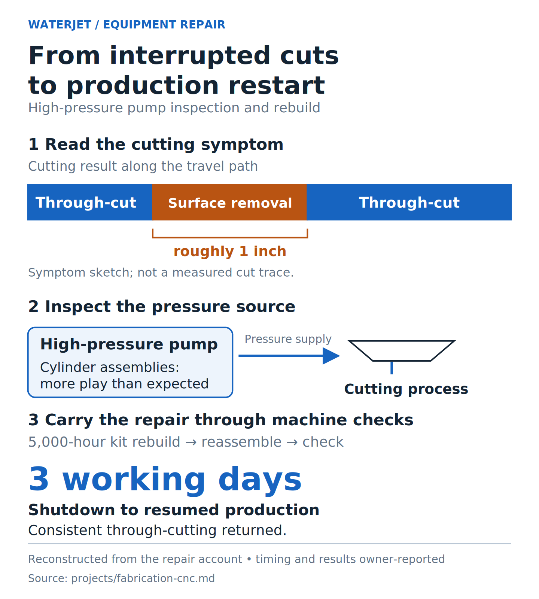
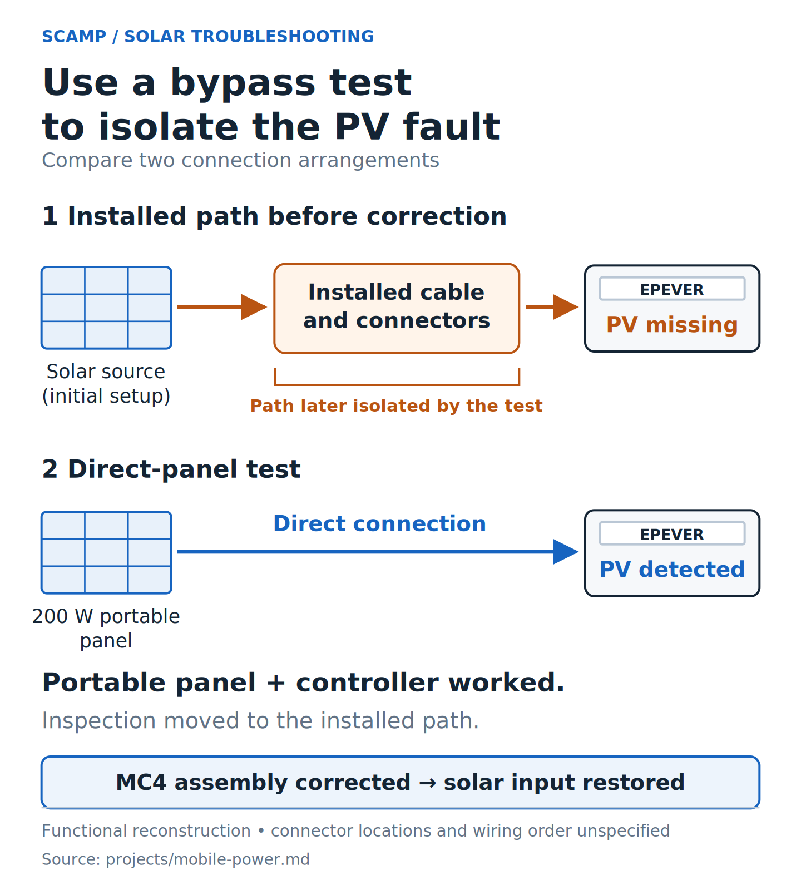
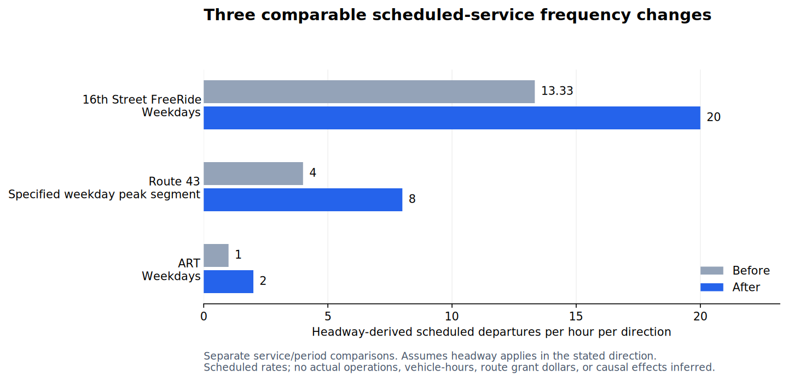
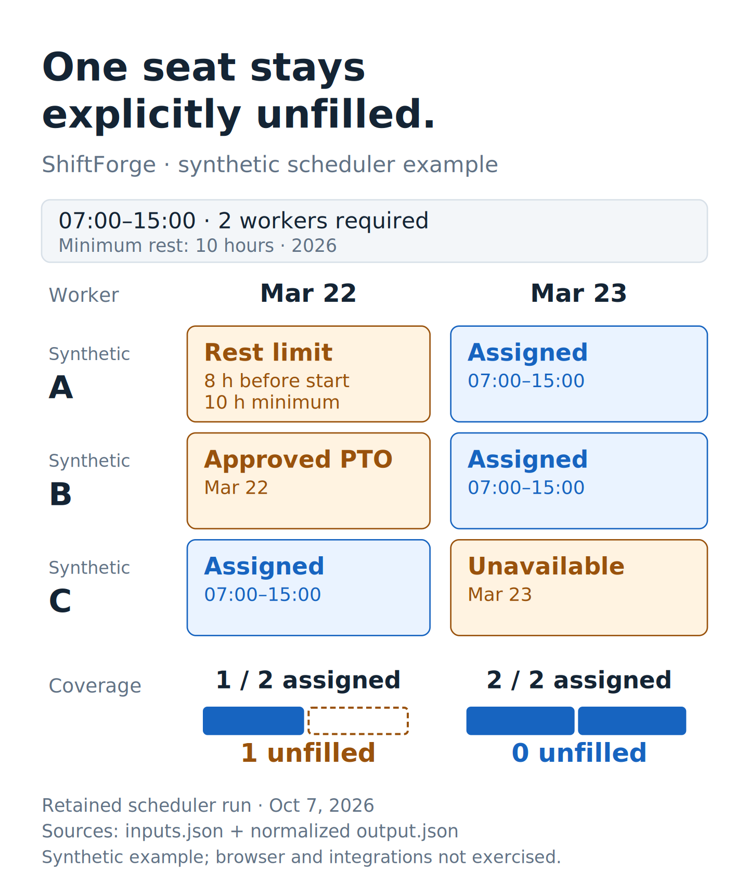

# Tucker Vana — Mechanical Engineering and Equipment Work

**Manufacturing · Fabrication and CNC repair · Equipment integration · Troubleshooting**

I’m a Colorado School of Mines mechanical engineering graduate, cum laude. My paid work combines technical planning with building, operating, and repairing equipment: production startup, custom fabrication, CNC equipment, scientific hardware, and practical operations. My independent projects extend that work into RV power, Linux systems, software development directed through AI coding agents, and Colorado public-data analysis.

The useful part is the decision and the check behind it. These pages explain my contribution, the constraints I worked through, the results I can account for, and the limits of the retained evidence.

[Experience](EXPERIENCE.md) · [Capabilities with examples](CAPABILITIES.md) · [Complete work index](WORK_INDEX.md) · [Supporting records](artifacts/README.md)

## Featured work

| Work | Contribution and evidence |
|---|---|
| [Production startup — Pouch Factory](projects/production-startup.md) | CAD/calculations, utilities, documentation, and hands-on line build and operation; the account identifies equipment break-in and an initial production run as the stage reached |
| [Fabrication and CNC repair](projects/fabrication-cnc.md) | Investigated intermittent loss of cut penetration, inspected and rebuilt the waterjet pump, and checked the restart; consistent cutting and a three-working-day return to production are reported in my account |
| [Sprinter and SCAMP power](projects/mobile-power.md) | Personally installed Sprinter house power and the SCAMP solar/shunt setup; the SCAMP case connects roof space and cost to panel choice, then uses a direct-panel test to isolate a connector fault |
| [Software development direction](projects/shiftforge.md) · [Lavatune](projects/lavatune.md) | AI coding agents wrote the implementation under my direction; inspect ShiftForge’s retained synthetic assignments and explicit shortage, or Lavatune’s repeated offline renderer measurements |
| [Colorado public-data analysis](projects/colorado-budget-research.md) | A source-linked transit award/service crosswalk, reproducible headway arithmetic, and route-identity checks; the measured unit is announced scheduled service |
| [Scientific hardware — Maybell Quantum](projects/cryogenic-hardware.md) | Instrument wiring, readout integration, and gas-valve controls; I handled most of the team’s Flexlines weld-test effort as a Maybell employee, working with outside partners and personally running additional tests |

## Inspect the work

[Browse the technical figures](artifacts/README.md#technical-figures) · [Read their evidence and scope](docs/FIGURE_GUIDE.md) · [Prepared post drafts](posts/README.md)

Preview the waterjet repair: cutting fault, pump inspection, production restart

The drawing is reconstructed from my repair account. [Inspect the supporting record](artifacts/fabrication-cnc/README.md).

Preview SCAMP solar fault isolation: installed path versus direct-panel test

The drawing explains the diagnostic comparison. [Inspect the account and installation photograph](artifacts/mobile-power/README.md).

Preview the transit analysis: three measurable scheduled-frequency changes

The chart is calculated from the retained public-source table. [Inspect the data and calculation](artifacts/colorado-transit-award-service/frequency-comparison.md).

Preview ShiftForge: constraints, assignments, and an explicit unfilled seat

Generated from retained synthetic inputs and actual normalized scheduler output. [Inspect the inputs, output, and execution scope](artifacts/shiftforge/README.md).

[Lavatune’s renderer comparison](artifacts/lavatune/README.md) retains five runs, the benchmark source, raw results, and operating conditions. Its timings cover offline simulation and material generation; live audio and terminal presentation are outside the measurement.

## Engineering work-sample packet

[Download the four-page PDF](artifacts/career-sheets/engineering-portfolio.pdf) · [View the illustrated case sheets](artifacts/career-sheets/README.md)

The packet focuses on three paid-work examples: production air supply, a waterjet pump rebuild, and prototype instrumentation. It pairs my contribution with a functional drawing, the decision or repair, and the reported project stage. Individual pages are available as PDF, PNG, and SVG.

[Application bullets and interview stories](docs/CAREER_PLAYBOOK.md) · [Firsthand details for the next revision](docs/OWNER_INPUTS.md)

## Additional work

VanaHR, Argus Audit, ShiftForge, and Lavatune were implemented by AI coding agents under my direction.

| Work | Focus |
|---|---|
| [VanaHR](projects/vanahr.md) | Onboarding workflows and a 15-minute application/database rollback requirement; production validation is recalled, with no dated timing record included |
| [Lavatune](projects/lavatune.md) | Local audio visualizer; public implementation, change history, and retained offline renderer measurements |
| [Argus Audit](projects/argus-audit.md) | On-device iOS photo-review prototype and controls around deletion |
| [ShiftForge](projects/shiftforge.md) | Scheduling constraints and application integrations; retained synthetic execution shows an uncovered seat |
| [CodexDeck](projects/codexdeck.md) | Linux workstation configuration, rebuild procedure, and acceptance checks; a fresh-machine restoration run is not retained |
| [RV power systems](projects/mobile-power.md) | Sprinter house power and SCAMP solar installation and fault isolation |
| [Colorado budget research](projects/colorado-budget-research.md) | Public-data models, source reconciliation, and measurement limits |
| [Mines capstone](projects/mines-capstone.md) | Mechanical engineering on a four-rotor wildfire-drone team |

[VanaHR’s recovery record](artifacts/vanahr/README.md) distinguishes the recalled rollback check from documented restoration-time and data-loss objectives.

## Current engineering analysis

[Compressed-air storage study](artifacts/air-storage-study/README.md) · [Three-page analysis PDF](artifacts/air-storage-study/air-storage-analysis.pdf)

Three calculated figures examine usable buffer time, required storage, and pressure recovery. Inputs, equations, data tables, and mathematical checks are retained. This is a current AI-assisted analysis with illustrative inputs, linked to the production-air case.

## Public technical record

The American Physical Society lists me as presenter and coauthor of **Scalable Flexible Coaxial Ribbon Cables for High-Density Quantum Wiring (Part II)** at the 2023 March Meeting. [View the APS record](https://meetings-archive.aps.org/mar/2023/q72/5/).

## Background

B.S. Mechanical Engineering, Colorado School of Mines, December 2021. Cum laude; 3.65 GPA.

My employment history includes Pouch Factory, Raw Creative, Tension Climbing, Maybell Quantum, and DBC Irrigation Supply. The [experience page](EXPERIENCE.md) keeps that history together.

These pages summarize selected professional and independent work. Private source documents and project code are not included.
