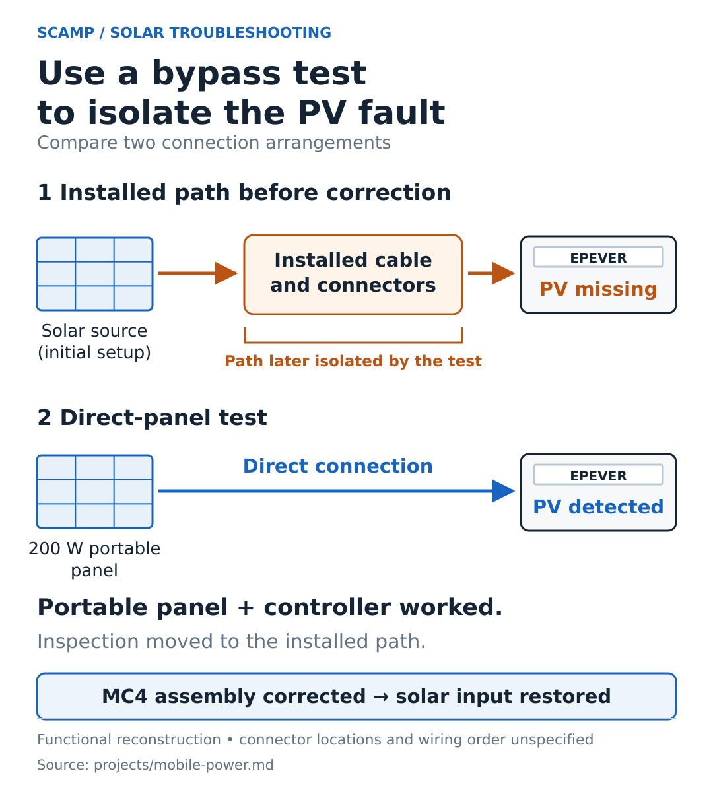
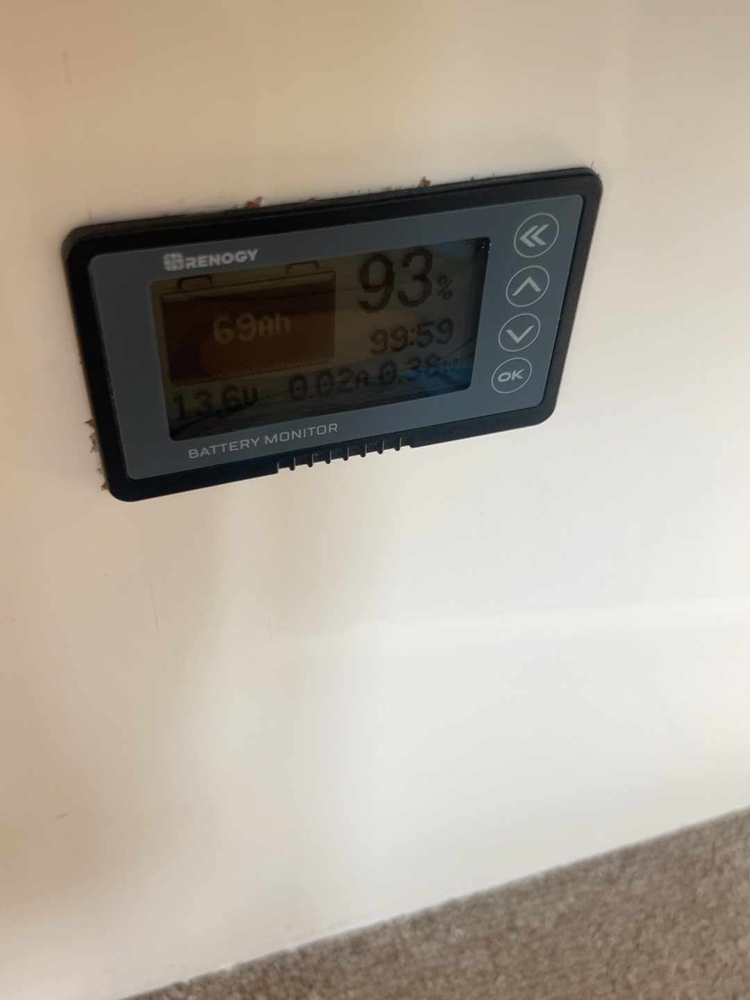

# Sprinter and SCAMP RV power: installation and fault isolation

**Tucker Vana · Independent project · Electrical integration and troubleshooting**

I personally installed and wired the full Sprinter house-power system and the SCAMP solar and battery-shunt monitoring setup. The projects involved fitting charging equipment, battery storage, protection, and monitoring into vehicles with existing electrical systems and limited space.

## Design decision: roof space and cost

The decision was how to add solar capacity within the SCAMP’s limited roof area and budget. I split the capacity between a small roof panel and a larger portable panel.

The SCAMP had limited roof area for solar. I used a 100 W roof panel and added an affordable 200 W portable panel through an Anderson connector. This expanded the available panel capacity without requiring more roof space. The selection was based on space and cost; I did not calculate a daily load budget before choosing it.

The split uses roof area for 100 W and a separate portable connection for the additional 200 W. Those panel ratings describe capacity; daily energy yield and fit to a measured load budget are not established in the retained account.

The retrofit uses an EPEVER controller, MC4 branch connectors, a 40 A controller fuse, and a shunt-based battery monitor. The controller's load terminals are unused.

## Troubleshooting: missing solar input

While investigating missing PV input, I found continuity in a cable run. I then connected the 200 W portable panel directly to the controller, which detected the panel in that configuration.

Continuity had not explained why the controller saw no PV input. The direct connection tested the panel and controller separately from the installed wiring path. It gave me a narrower place to look.

The direct connection narrowed the fault to the installed wiring and connector path. I found an improperly assembled MC4 connector that I had made, corrected it, and restored solar input.

That final check was restored input after the connector correction. It is my installation and troubleshooting account; numerical fault readings and a dated before/after test record are not retained here. The functional figure compares the two connection configurations; it groups the installed wiring and connectors because their physical order is not retained.

## Second implementation: Sprinter house power

The van manual records two 100 W Renogy panels, a 280 Ah Eco-Worthy lithium battery, charge control, a main breaker, disconnect, bus bars, and fused DC distribution. Its equipment list includes a refrigerator, lights, ventilation fan, diesel heater, and portable power station. The manual also contains vehicle service specifications, inspection notes, and maintenance photos.

## Supporting fault-isolation figure

Reconstructed from the troubleshooting account. [Supporting record](../artifacts/mobile-power/README.md).

## Hardware

The installed monitor displays approximately 13.6 V, 0.02 A, and 93% charge in this photo. Those are display readings, not an independent battery-capacity measurement.

The work covered equipment choice, installation, and checking a fault on a system I had wired. The direct-panel comparison was the useful diagnostic step: it separated the panel/controller from the installed path before I corrected the connector.
